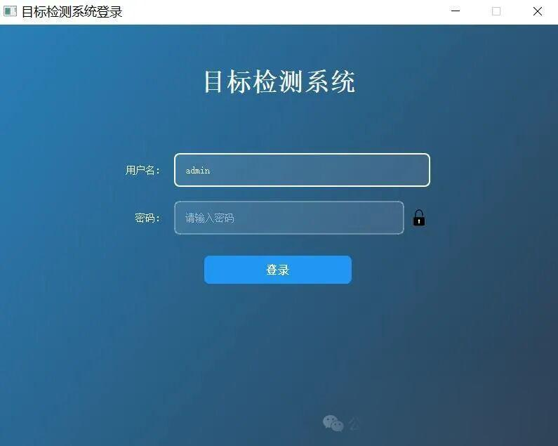
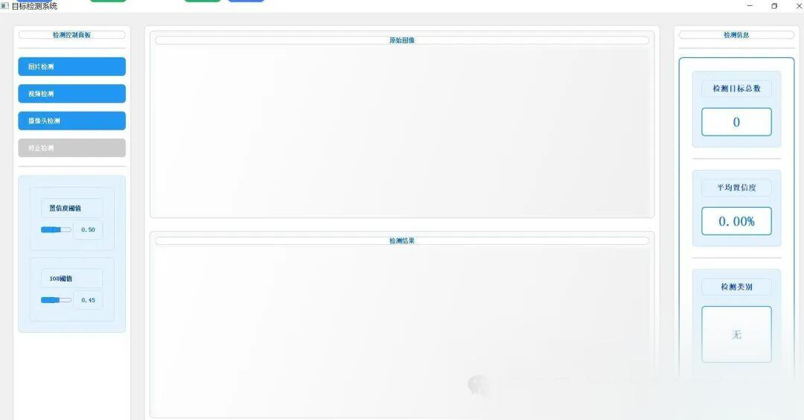

# Python source code for the general detection system framework design based on YOLOv11+PyQt5

YOLOv11 Object Detection System This is a target detection system based on YOLOv11 and PyQt5, featuring a beautiful login interface and comprehensive functionality.

## YOLOv11 Object Detection System

This is a target detection system based on YOLOv11 and PyQt5, featuring a beautiful login interface and a comprehensive detection interface.

### Function Characteristics

#### Login Interface



-

Modern tech-style interface design

-

Supports username and password authentication.

-

Password Display/Hide Switch Function

-

Error message when login fails

-

Supports quick login with the Enter key.

-

Default username and password: admin/admin

#### Detection Interface



-

Supports real-time detection of images, videos, and cameras.

-

Left-side control panel, including:

-

Detection mode selection (Image/Video/Camera)

-

Confidence threshold adjustment (0-1)

-

IOU threshold adjustment (0-1)

-

The right display area, including:

-

Original image/video display

-

Detection results image/video display

-

Real-time detection information (total number of detections, average confidence, detection categories)

-

Real-time updates of detection information

-

Supports stop detection function.

### Environmental Requirements

-

Python 3.8+

-

PyQt5

-

OpenCV

-

YOLOv11

-

Other dependencies (see requirements.txt)

### Installation Steps

1.

Clone or download project code

1.

Install dependency packages:

```
pip install -r requirements.txt

```

-

1

1.

Download the YOLOv11 model file (default is YOLOv11n.pt)

### Operational Process

1.

Startup program:

```
python main.py

```

-

1

1.

Login system:

-

Input username: admin

-

Input password: admin

-

Click the login button or press the Enter key.

1.

Using detection system:

-

Select detection mode (Image/Video/Camera)

-

Adjust detection parameters (confidence/IOU thresholds)

-

View the test results.

-

Click the "Stop Detection" button when needed.

### File Structure

- `main.py`

: Program entry file

- `login.py`

: Implementation of login interface

- `detector.py`

: Detection interface implementation

- `requirements.txt`

: Project Dependency List

- `icons/`

: Icon resource folder

- `YOLOv11n.pt`

YOLOv11 model file

### Notes

1.

The first run requires downloading the YOLOv11 model file.

1.

Ensure the camera is available when using a camera for detection.

1.

Video detection supports common video formats.

1.

Detection parameters can be adjusted in real-time as needed.

### Development Instructions

-

Building graphical interface using PyQt5

-

Target detection using YOLOv11

-

Process images and videos using OpenCV

-

The interface design adopts a modern technological style.

### Update Log

#### v1.0.0

-

Initial version release

-

Implement basic login and detection functions

-

Supports image, video, and camera detection.

-

Add parameter adjustment function


## Payment

Here is a pay link on Stripe ( https://buy.stripe.com/3cs8yP7sY87d0vu9AB ). Please contact me lonlonago@foxmail.com after funding $89, and I will send you a complete data files , thank you!


